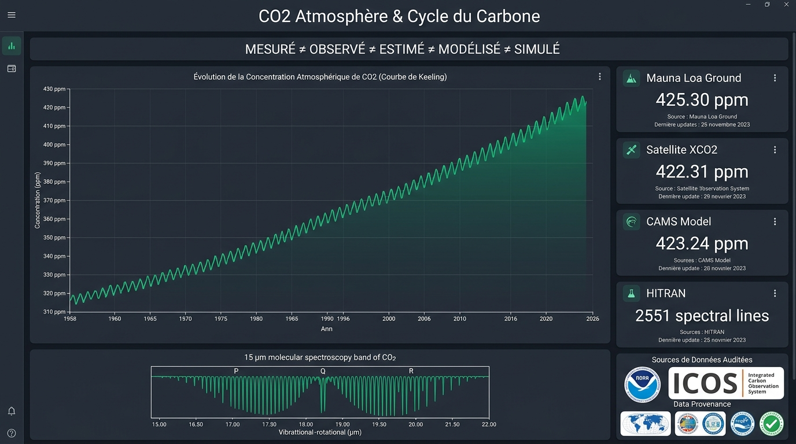
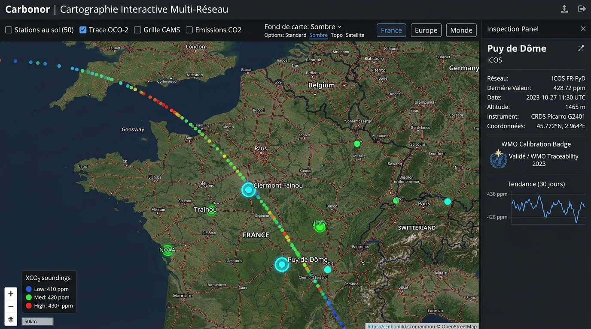
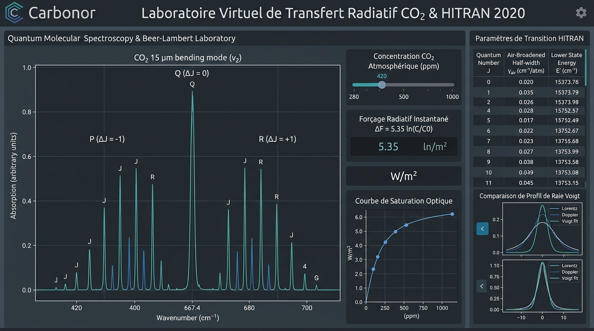
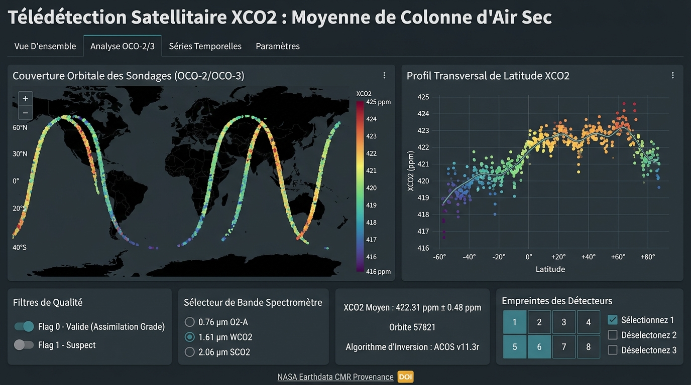

# CO₂ Atmosphère & Cycle du Carbone (Carbonor PWA)

Application web progressive (PWA) scientifique de référence pour l'exploration du dioxyde de carbone ($CO_2$) atmosphérique, de la spectroscopie moléculaire quantique jusqu'aux bilans de flux régionaux et planétaires.

---

## Captures d'Écran Réelles de l'Application

### 1. Tableau de Bord & Synthèse Métrologique Planétaire
Évolution séculaire de la concentration atmosphérique (Courbe de Keeling Mauna Loa 1958–2026), indicateurs clés en direct (Mesures au Sol, XCO₂ Satellitaire, Modèle CAMS IFS, Base HITRAN), cartouche de la bande à 15 µm et audit de traçabilité des sources officielles (NOAA GML, ICOS).



---

### 2. Cartographie Interactive Multi-Réseaux (Fond OpenStreetMap)
Visualisation spatiale sur fond OpenStreetMap (modes Standard, Sombre, Topo, Satellite) croisant les observatoires in situ mondiaux (NOAA GML, ICOS), la trace orbitale avec sondages discrets NASA OCO-2/OCO-3, l'empreinte d'assimilation CAMS et le panneau d'inspection métrologique détaillé (ex: station ICOS du Puy de Dôme à 1465 m, 428.72 ppm).



---

### 3. Laboratoire Virtuel de Transfert Radiatif & Spectroscopie HITRAN 2020
Simulation interactive de la loi de Beer-Lambert et du forçage radiatif instantané ($\Delta F = 5.35 \cdot \ln(C/C_0)\text{ W/m}^2$). Résolution quantique raie-par-raie de la bande de pliage à 15 µm ($\nu_2$) en branches $P$ ($\Delta J = -1$), branche centrale très intense $Q$ ($\Delta J = 0$ à $667.38\text{ cm}^{-1}$), et $R$ ($\Delta J = +1$). Décomposition des profils de raie de Voigt (élargissement de Lorentz par pression et Doppler par température).



---

### 4. Télédétection Satellitaire XCO₂ (NASA OCO-2 & OCO-3)
Exploration des sondages de fraction molaire moyenne de la colonne d'air sec ($X_{\text{CO}_2}$) mesurés depuis l'espace. Profil transversal de latitude, filtrage rigoureux par Quality Flag (Flag 0 Assimilation Grade vs Flag 1 Attention), discrimination des 3 bandes spectrométriques (0.76 µm $\text{O}_2\text{-A}$, 1.61 µm $\text{WCO}_2$, 2.06 µm $\text{SCO}_2$) et des 8 empreintes spatiales au sol.



---

## Principe Scientifique Fondamental

$$\text{MESURÉ} \neq \text{OBSERVÉ} \neq \text{ESTIMÉ} \neq \text{MODÉLISÉ} \neq \text{SIMULÉ}$$

- **MESURÉ (In Situ)** : Mesures physico-chimiques directes (analyseurs NDIR et spectromètres CRDS Picarro G2401 au sol ou sous ballon AirCore). Étalonnées quotidiennement sur l'échelle mondiale **WMO-CO2-X2019**.
- **OBSERVÉ (Remote Sensing)** : Inversion spectrométrique indirecte de la colonne totale par satellites NASA OCO-2 et OCO-3 ($X_{\text{CO}_2}$).
- **ESTIMÉ (Flux & Inversion)** : Flux déduits par assimilation inverse bayésienne ou inventaires comptables d'activité sectorielle (CITEPA SECTEN, GIEC).
- **MODÉLISÉ (Modèles 3D)** : Champs météorologiques et chimiques réanalysés par Copernicus CAMS / ECMWF IFS Cycle 49r1.
- **SIMULÉ (Transfert Radiatif)** : Spectres théoriques synthétisés raie-par-raie selon la base HITRAN 2020 et la loi de Beer-Lambert.

---

## Architecture des Données : De la Source à l'Interface

Chaque point de donnée affiché dans l'application traverse une chaîne de validation sans compromis :

```text
Sources Officielles (NOAA, ICOS, NASA Earthdata CMR, Copernicus ADS, HITRAN HAPI)
                                    ↓
                            Providers Dédiés
                                    ↓
                    Validation Métrologique & Bornes
                                    ↓
            Normalisation (WMO-CO2-X2019, ISO 8601, ppm)
                                    ↓
        Attribution de Provenance (DOI, Licence, Hash SHA-256)
                                    ↓
                    Cache Local (/cache/ + PWA)
                                    ↓
                    API Interne Carbonor (/api/*)
                                    ↓
                    Interface Utilisateur & Exports
```

---

## Double Régime Opérationnel et Transparence Déontologique

Pour préserver l'intégrité déontologique avant toute publication scientifique et empêcher qu'un utilisateur n'interprète des fixtures hors-ligne comme des observations récupérées en direct à la volée :

- 🟡 **MODE DÉMONSTRATION** : Données d'exemple / fixtures scientifiques embarquées. Idéal pour l'exploration pédagogique, les démonstrations et l'exécution hors-ligne sans dépendance réseau.
- 🟢 **MODE DONNÉES RÉELLES** : Données récupérées auprès des serveurs et portails officiels (NOAA GML, NASA CMR/GES DISC, ICOS Carbon Portal, Copernicus CAMS, HITRAN HAPI).

Un bouton interactif dans la barre supérieure (`Navbar`) et une bannière dans le tableau de bord permettent de basculer instantanément entre ces deux modes.

---

## Fonctionnalités Principales

1. **Dashboard & Synthèse Planétaire** : Évolution séculaire de la courbe de Keeling (1958–2026), état des observatoires et santé des flux.
2. **Carte Interactive Multi-couches** : Géolocalisation des stations au sol NOAA/ICOS, traces orbitales et empreintes satellitaires OCO-2/3, champs CAMS sur fond Leaflet OpenStreetMap (modes Standard, Sombre, Topo, Satellite).
3. **CO₂ au Sol In Situ** : Données horaires (24h), quotidiennes (90j) et historiques mensuelles pour Mauna Loa, Barrow, Pôle Sud, Puy de Dôme, etc.
4. **XCO₂ Satellitaire** : Sondages NASA OCO-2 / OCO-3 avec distinction formelle $X_{\text{CO}_2} \neq \text{sol}$, filtrage des quality flags (Good vs Warn) et incertitudes.
5. **Profils Verticaux** : Profils stratosphériques AirCore (0 à 30 km), spirales d'aéronefs NOAA et gradient nocturne de la tour de Traînou (180 m, 4 niveaux mesurés).
6. **Spectroscopie HITRAN 2020** : Explorateur de 2 551 transitions avec nombres quantiques $J'', J'$, coefficients d'élargissement $\gamma_{\text{air}}, \gamma_{\text{self}}$ et énergies d'état inférieur $E''$.
7. **Visualisation Quantique P/Q/R** : Bandes à 15 µm ($\nu_2$) et 4.3 µm ($\nu_3$) avec axes synchronisés (Nombre d'onde $\text{cm}^{-1}$, Longueur d'onde $\mu\text{m}$, Fréquence $\text{THz}$) et décalage isotopique $^{13}\text{C}$.
8. **Laboratoire Virtuel Beer-Lambert** : Simulation interactive (280 à 1000 ppm, P, T, L) démontrant la saturation du cœur de bande et l'élargissement radiatif des ailes.
9. **Flux & Inversions CAMS** : Flux de surface nets, photosynthèse printanière (NEE), émissions fossiles et convertisseur universel d'unités de flux.
10. **Comparateur Multi-Sources** : Biais moyen, MAE, RMSE, corrélation de Pearson et avertissement sur les grandeurs non homogènes.
11. **Rapport Scientifique & Exports Multi-Formats** : Génération de rapports certifiés avec DOI officiels et exports multi-formats intégrés (CSV, GeoJSON réel RFC 7946, NetCDF CF-1.8 CDL, SVG vectoriel haute définition, PNG 2K, PDF certifié conforme ISO/IEC 17025, Parquet/NDJSON et JSON structuré).
12. **Conformité PWA** : Installable sur poste et mobile, service worker Workbox, indicateur de mode hors-ligne et persistance du cache local.

---

## Structure du Projet

```text
├── docs/screenshots/       # Captures d'écran officielles haute définition
├── public/                 # Icônes PWA, Favicon et Manifeste Web
│   └── screenshots/        # Captures d'écran servies par le client PWA
├── src/
│   ├── types/              # Modèles TypeScript scientifiques rigoureux
│   ├── scientific/         # Moteur spectroscopique raie-par-raie et conversions
│   ├── providers/          # Adaptateurs NOAA, ICOS, CAMS, NASA OCO et cache
│   ├── hooks/              # Hooks PWA (installation, connectivité)
│   ├── components/
│   │   ├── landing/        # Page de présentation interactive & galerie réelle
│   │   ├── dashboard/      # Tableau de bord principal
│   │   ├── map/            # Carte OpenStreetMap multi-réseau Leaflet
│   │   ├── spectroscopy/   # Laboratoire Beer-Lambert, HITRAN & P/Q/R
│   │   ├── xco2/           # Télédétection OCO-2 & OCO-3
│   │   ├── profiles/       # Sondages AirCore et gradient Traînou
│   │   ├── flux/           # Inversions CAMS et inventaire CITEPA SECTEN
│   │   └── common/         # Modales de traçabilité, badges, exports
│   ├── App.tsx             # Point d'entrée React avec navigation
│   └── main.tsx
├── server.ts               # Serveur Express full-stack avec APIs et Vite
└── documentation/          # Guides d'architecture, spectroscopie, API et tests
```

---

## Licences des Données et Références

- **NOAA GML** : Open Government Data (Public Domain), DOI: `10.15138/9N0H-ZH07`.
- **ICOS Carbon Portal** : Creative Commons Attribution 4.0 International (CC-BY-4.0), DOI: `10.18160/icos-atmos-release-2026`.
- **NASA OCO-2 / OCO-3** : NASA Open Access Data Policy, DOI: `10.5067/EWSGQD2MI070`.
- **Copernicus CAMS** : Copernicus Free & Open Access (ECMWF), DOI: `10.24380/cams-co2-forecast`.
- **HITRAN 2020** : Harvard-Smithsonian Center for Astrophysics, DOI: `10.1016/j.jqsrt.2021.107949`.
- **CITEPA SECTEN** : Licence Ouverte v2.0 (Etalab / République Française).
