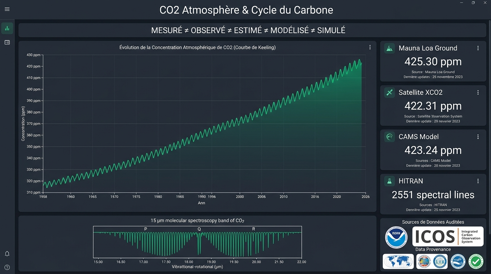
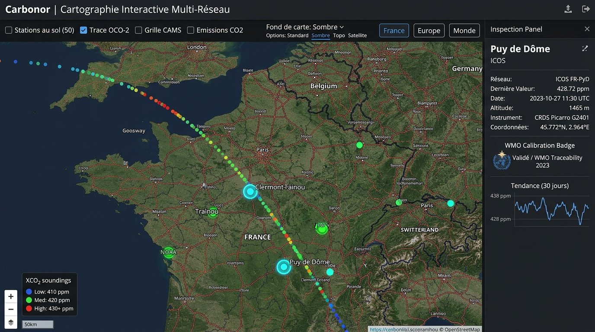
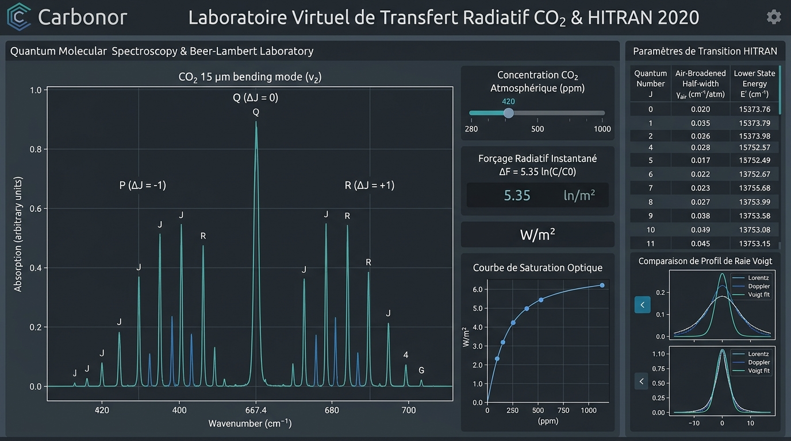
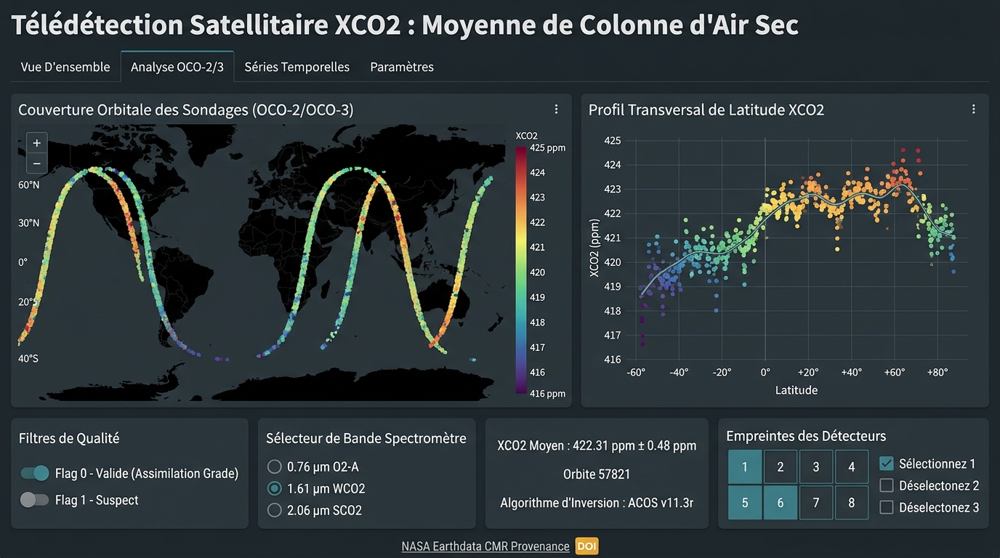

<p align="center">
  
</p>

<h1 align="center">🌍 Carbonor — CO₂ Atmosphère &amp; Cycle du Carbone</h1>

<p align="center">
  <strong>Observatoire scientifique interactif (PWA) pour explorer le dioxyde de carbone atmosphérique, de la physique quantique HITRAN aux mesures planétaires NOAA, ICOS, NASA OCO et Copernicus CAMS.</strong>
</p>

<p align="center">
  
  
  
  
  
</p>

---

> [!IMPORTANT]
> **Clause de Non-Responsabilité sur les Données :** Les mesures, séries temporelles, champs modélisés, inventaires et paramètres spectraux affichés dans Carbonor proviennent de portails scientifiques tiers (NOAA GML, ICOS, NASA Earthdata, Copernicus CAMS, HITRAN, CITEPA) ou de jeux d'exemple embarqués en mode Démonstration. **L'éditeur de l'application (`Jean-Pierre Nouhailler`) n'est pas responsable des données fournies, affichées ou calculées dans l'application.**

---

## ✨ Nouveautés majeures (v2.6.0)

| Fonctionnalité | Icône | Description |
| :--- | :---: | :--- |
| **Paramètres Système &amp; Mises à jour** | ⚙️ | Affiche la **date de sortie**, la **dernière vérification**, les boutons **« Vérifier les mises à jour »** et **« Forcer la mise à jour »**, ainsi qu'un moteur de **mises à jour automatiques en arrière-plan** (vérification périodique + installation silencieuse Service Worker). |
| **Onboarding Légal &amp; Non-Responsabilité** | ⚖️ | Modale d'accueil au premier lancement présentant les repères novices et la **clause explicite de non-responsabilité** sur les données fournies. |
| **Onboarding Contextuel &amp; Infobulles Champ par Champ** | 🧭 | Encadré explicatif adapté aux débutants en haut de **chaque écran**, accompagné d'infobulles interactives **`?`** à côté de chaque champ, curseur, sélecteur et filtre. |
| **Thème Clair &amp; Thème Sombre** | 🌗 | Bascule instantanée et persistante entre le **Thème Sombre** (*Observatoire de nuit*) et le **Thème Clair** (*Revue scientifique de jour*), y compris sur la landing page et les cartes Leaflet. |
| **Logo dédié &amp; Bouton « Installer l'application »** | 📲 | Identité visuelle vectorielle (`public/logo.svg`) et bouton explicite **« Installer l'application »** pour ajouter Carbonor sur l'écran d'accueil d'un mobile (iOS/Android) ou d'un bureau (Windows/macOS/Linux). |

---

## 📸 Captures d'Écran de l'Application

### 1. 📊 Tableau de Bord &amp; Synthèse Métrologique Planétaire
Évolution séculaire de la concentration atmosphérique (Courbe de Keeling Mauna Loa 1958–2026), indicateurs clés en direct (Mesures au Sol, XCO₂ Satellitaire, Modèle CAMS IFS, Base HITRAN), cartouche de la bande à 15 µm et audit de traçabilité des sources officielles (NOAA GML, ICOS).



---

### 2. 🗺️ Cartographie Interactive Multi-Réseaux (Fond OpenStreetMap)
Visualisation spatiale sur fond OpenStreetMap (modes Standard, Sombre, Topo, Satellite) croisant les observatoires in situ mondiaux (NOAA GML, ICOS), la trace orbitale avec sondages discrets NASA OCO-2/OCO-3, l'empreinte d'assimilation CAMS et le panneau d'inspection métrologique détaillé (ex: station ICOS du Puy de Dôme à 1465 m, 428.72 ppm).



---

### 3. 🔬 Laboratoire Virtuel de Transfert Radiatif &amp; Spectroscopie HITRAN 2020
Simulation interactive de la loi de Beer-Lambert et du forçage radiatif instantané ($\Delta F = 5.35 \cdot \ln(C/C_0)\text{ W/m}^2$). Résolution quantique raie-par-raie de la bande de pliage à 15 µm ($\nu_2$) en branches $P$ ($\Delta J = -1$), branche centrale très intense $Q$ ($\Delta J = 0$ à $667.38\text{ cm}^{-1}$), et $R$ ($\Delta J = +1$). Décomposition des profils de raie de Voigt (élargissement de Lorentz par pression et Doppler par température).



---

### 4. 🛰️ Télédétection Satellitaire XCO₂ (NASA OCO-2 &amp; OCO-3)
Exploration des sondages de fraction molaire moyenne de la colonne d'air sec ($X_{\text{CO}_2}$) mesurés depuis l'espace. Profil transversal de latitude, filtrage rigoureux par Quality Flag (`Flag 0` Assimilation Grade vs `Flag 1` Attention), discrimination des 3 bandes spectrométriques (0.76 µm $\text{O}_2\text{-A}$, 1.61 µm $\text{WCO}_2$, 2.06 µm $\text{SCO}_2$) et des 8 empreintes spatiales au sol.



---

## 🧪 Principe Scientifique Fondamental

$$\text{MESURÉ} \neq \text{OBSERVÉ} \neq \text{ESTIMÉ} \neq \text{MODÉLISÉ} \neq \text{SIMULÉ}$$

| Catégorie | Badge | Nature de la donnée | Exemples dans Carbonor |
| :--- | :---: | :--- | :--- |
| **MESURÉ** *(In Situ)* | 🟢 Émeraude | Mesures physico-chimiques directes (NDIR, CRDS Picarro G2401), étalonnées sur **WMO-CO2-X2019**. | Mauna Loa (NOAA), Puy de Dôme (ICOS), AirCore |
| **OBSERVÉ** *(Remote)* | 🔵 Cyan | Inversion spectrométrique indirecte de la colonne totale d'air sec depuis l'espace. | NASA OCO-2 &amp; OCO-3 ($X_{\text{CO}_2}$) |
| **ESTIMÉ** *(Flux)* | 🟡 Ambre | Flux déduits par inversion bayésienne ou inventaires comptables sectoriels. | CITEPA SECTEN, Inversions CAMS |
| **MODÉLISÉ** *(3D)* | 🟣 Violet | Champs atmosphériques 3D issus d'assimilation 4D-Var et mécanique des fluides. | Copernicus CAMS / ECMWF IFS Cycle 49r1 |
| **SIMULÉ** *(Radiatif)* | 🔴 Rose | Spectres théoriques calculés raie-par-raie par mécanique quantique et Beer-Lambert. | Base HITRAN 2020, Profils Voigt Faddeeva |

---

## 🏗️ Architecture des Données &amp; Mises à Jour Automatiques

```text
Sources Officielles (NOAA, ICOS, NASA CMR, Copernicus ADS, HITRAN HAPI)
                                    ↓
                            Providers Dédiés
                                    ↓
                     Validation Métrologique & Bornes
                                    ↓
             Normalisation (WMO-CO2-X2019, ISO 8601, ppm)
                                    ↓
         Attribution de Provenance (DOI, Licence, Hash SHA-256)
                                    ↓
                 Cache Local (/cache/ + Workbox Service Worker)
                                    ↓
                 API Interne (/api/* & /api/system/version)
                                    ↓
             Interface React (Thème Sombre/Clair + Guides Novices)
```

- **Double régime opérationnel** : basculez dans l'application entre 🟡 **Mode Démonstration** (fixtures embarquées hors-ligne) et 🟢 **Mode Données Réelles** (serveurs officiels).
- **Mises à jour automatiques en arrière-plan** : un polling régulier (`/api/system/version` et `/version.json`) couplé au cycle `registerSW` de Workbox détecte et installe automatiquement les nouvelles versions. Les utilisateurs peuvent aussi cliquer sur **« Vérifier les mises à jour »** ou **« Forcer la mise à jour »** depuis le menu ⚙️ **Paramètres**.

---

## 🚀 Démarrage Rapide

```bash
# 1. Installer les dépendances
npm install

# 2. Lancer le serveur de développement (Express + Vite sur port 3000)
npm run dev

# 3. Exécuter la suite de tests scientifiques & UI
npx vitest run

# 4. Construire la version de production (PWA + Workbox)
npm run build
```

> [!TIP]
> **Installation sur mobile &amp; ordinateur :** cliquez sur le bouton **« Installer l'application »** dans la barre supérieure (ou dans ⚙️ **Paramètres**) pour épingler Carbonor sur votre écran d'accueil iOS/Android ou sur votre bureau Windows/macOS/Linux.

---

## 📚 Documentation Technique Complète

| Document | Contenu |
| :--- | :--- |
| 📄 [`CONTEXT.md`](CONTEXT.md) | Contexte métier, architecture applicative, système de thèmes, onboarding et cycle PWA |
| 📝 [`CHANGELOG.md`](CHANGELOG.md) | Historique détaillé des versions et évolutions (`v1.0.0` → `v2.6.0`) |
| 🏛️ [`ARCHITECTURE.md`](ARCHITECTURE.md) | Conception modulaire, providers et couche serveur Express |
| 🔌 [`API.md`](API.md) | Spécification des endpoints REST `/api/*` |
| 🌐 [`DATA_SOURCES.md`](DATA_SOURCES.md) | Provenance, licences et DOI officiels des 7 sources |
| 📐 [`SCIENTIFIC_METHODS.md`](SCIENTIFIC_METHODS.md) | Formules physiques, conversions CODATA et validations |
| 🔬 [`SPECTROSCOPY.md`](SPECTROSCOPY.md) | Moteur spectroscopique raie-par-raie HITRAN &amp; Faddeeva Voigt |
| ☁️ [`CLOUDFLARE_DEPLOYMENT.md`](CLOUDFLARE_DEPLOYMENT.md) | Guide complet de déploiement Cloudflare Pages |
| 🧪 [`TESTING.md`](TESTING.md) | Plan de tests Vitest &amp; couverture métrologique |

---

## 📜 Licences des Données &amp; Code

- **Code applicatif Carbonor** : Licence Open-Source **MIT** (2026 — Jean-Pierre Nouhailler).
- **NOAA GML** : Open Government Data (Public Domain) — DOI : `10.15138/9N0H-ZH07`.
- **ICOS Carbon Portal** : Creative Commons Attribution 4.0 (`CC-BY-4.0`) — DOI : `10.18160/icos-atmos-release-2026`.
- **NASA OCO-2 / OCO-3** : NASA Open Access Data Policy — DOI : `10.5067/EWSGQD2MI070`.
- **Copernicus CAMS** : Copernicus Free &amp; Open Access (ECMWF) — DOI : `10.24380/cams-co2-forecast`.
- **HITRAN 2020** : Harvard-Smithsonian Center for Astrophysics — DOI : `10.1016/j.jqsrt.2021.107949`.
- **CITEPA SECTEN** : Licence Ouverte v2.0 (Etalab / République Française).
